# Self-Learning AI Agent

**A Self-Learning AI Agent that learns from experience**

Final-year B.Tech project · Computer Science and Engineering (AI Specialization) · 2023–2027

- **Team:** Brahmanand Mathpati · Atharv Gundale · Vedant Biradar · Somesh Badwane
- **College:** TODO: full college name
- **Live app:** <https://self-learning-ai-agent-final-year-project.streamlit.app/>
- **GitHub:** <https://github.com/brahmanandmathpati/Self-Learning-AI-Agent>
- **PDF version:** [Self-Learning-AI-Agent_Project_Documentation.pdf](Self-Learning-AI-Agent_Project_Documentation.pdf)

Document by **Brahmanand Mathpati**

## Contents

  - [Certificate and declaration](#certificate)
  - [Acknowledgement](#acknowledgement)
  - [Abstract](#abstract)
- **Part A — The idea**
  - [6. Introduction](#s6)
  - [7. Problem statement and objectives](#s7)
  - [8. Background in plain words](#s8)
- **Part B — How it is built**
  - [9. System architecture](#s9)
  - [10. Environments](#s10)
  - [11. Agents](#s11)
  - [12. Training pipeline](#s12)
  - [13. Evaluation and statistics](#s13)
  - [14. Ablation study](#s14)
  - [15. Reflection layer](#s15)
  - [16. Database design](#s16)
  - [17. The website (dashboard)](#s17)
  - [18. Accounts and security](#s18)
  - [19. Vision Lab: learning from photos, videos and live gestures](#s19)
- **Part C — Proof**
  - [20. Results](#s20)
  - [21. Vision Lab results](#s21)
  - [22. Testing and quality](#s22)
- **Part D — Using and running it**
  - [23. Installation and running locally](#s23)
  - [24. Deployment on Streamlit Community Cloud](#s24)
  - [25. User guide: the first 10 minutes](#s25)
  - [26. Folder structure](#s26)
- **Part E — Reflection**
  - [27. Challenges and how we solved them](#s27)
  - [28. Limitations and future work](#s28)
  - [29. Conclusion](#s29)
  - [30. Team contributions](#s30)
  - [31. Glossary](#s31)
  - [32. Viva questions and answers](#s32)
  - [33. References](#s33)

<a id="certificate"></a>
## Certificate and declaration

**Certificate.** This is to certify that the project report titled **“Self-Learning AI Agent”** is a bona fide record of
the work carried out by Brahmanand Mathpati, Atharv Gundale, Vedant Biradar and Somesh Badwane, students of B.Tech
Computer Science and Engineering (AI Specialization), in partial fulfilment of the requirements for the award of the
degree of Bachelor of Technology during the academic year **TODO: 2026–27**, under my guidance.

| | |
|---|---|
| Project guide | **TODO: guide’s name and designation** |
| Head of Department | **TODO: HOD’s name** |
| Date / place | **TODO** |

**Declaration.** We declare that this report describes our own work. Every result in it was produced by the code in
the project repository and can be reproduced from the committed results database (`data/demo/sla_demo.db`).
Sources we used are listed in the References.

Signatures: Brahmanand Mathpati · Atharv Gundale · Vedant Biradar · Somesh Badwane — **TODO: sign and date**

<a id="acknowledgement"></a>
## Acknowledgement

We thank our project guide, **TODO: guide’s name**, for steady guidance and honest feedback; our Head of Department,
**TODO: HOD’s name**, and the faculty of the Department of Computer Science and Engineering for their support; and our
families and friends for their patience. We also thank the open-source communities behind Gymnasium, PyTorch,
Streamlit, Plotly, SciPy and MediaPipe, whose free tools made this project possible.

<a id="abstract"></a>
## Abstract

Most programs that are called “AI agents” do not really learn: they answer from fixed knowledge. This project builds an
agent that **starts with no knowledge and measurably improves from experience** using reinforcement learning, and then
**proves** the improvement with fair tests.

The agent learns two games from the Gymnasium library. On FrozenLake, a tabular Q-learning agent learns to cross the ice
and reaches the goal in **100%** of held-out test games (mean 1.000 over 5 seeds), compared with **1.2%** for a random
player. On CartPole, a Deep Q-Network (DQN) built from scratch in PyTorch balances the pole for **425.92 ± 122.59** steps
on average (out of 500), against **22.58** for a random player and **25.63** before training. The gain over random is
**+403.34** steps (95% bootstrap interval 291.22–474.74; Welch’s t-test p = 0.0018). An ablation study shows that both
DQN parts matter: removing replay memory drops the score to **86.79**, and removing the target network drops it to
**9.36**.

Every run, episode and test is stored in a SQLite database and shown on a Streamlit website with a live training view,
a grounded plain-language “reflection” layer, accounts with a view-only guest mode, and a **Vision Lab** where the agent
learns hand gestures from a webcam, photos or videos, and where the user’s 👍/👎 gestures act as rewards for the
FrozenLake agent. The project has 220 automated tests.

**Keywords:** reinforcement learning, Q-learning, Deep Q-Network, experience replay, statistical evaluation, ablation,
human-in-the-loop learning, hand-gesture recognition, Streamlit.

# Part A — The idea

<a id="s6"></a>
## 6. Introduction

### 6.1 What “self-learning” means in this project

A program **learns** when its own numbers change because of experience and, as a result, it does better next time.
In this project the “numbers” are either a **Q-table** (a table of scores, one per situation and move) or the
**weights** of a small neural network. Nothing else counts as learning. In particular, saving chat history, changing a
prompt or asking a language model to write text are **not** learning, because they do not make the agent play better.

> **Analogy.** A student who memorises a textbook can repeat it, but a student who practises problems, checks the
> answers and adjusts how they solve them actually gets better. Our agent is the second student: it practises a game
> thousands of times, gets a score after each move, and slowly changes its strategy.

### 6.2 Why this matters

Many demos call themselves “self-learning” without showing any proof. We wanted a project where:

1. the learning is **real** (numbers inside the agent change),
2. the improvement is **measured fairly** (on games the agent never practised on), and
3. the result is **checked with statistics**, so it cannot be explained by luck.

### 6.3 What we built (in one paragraph)

A reinforcement-learning system in Python with three agents (random, Q-learning, DQN), two environments (FrozenLake,
CartPole), a training pipeline that runs several seeds, a fair evaluation step with statistics, an ablation study, a
SQLite database that stores every result, a reflection layer that explains results in plain language without inventing
numbers, a Streamlit website with accounts, and a Vision Lab that learns hand gestures and lets gestures reward the agent
(Figure 1 in Section 9 shows the whole system).

<a id="s7"></a>
## 7. Problem statement and objectives

**Problem statement.** Build an agent that starts with no trained policy and improves its performance through
reinforcement learning, and demonstrate that improvement with held-out evaluation, statistical tests and an ablation
study — not with claims.

**Objectives** (each one is measurable, and Section 20 reports the result):

| # | Objective | How it is measured | Result |
|---|---|---|---|
| O1 | Learn FrozenLake from rewards alone | Success rate on 100 held-out test games × 5 seeds | **1.000** vs random 0.012 |
| O2 | Learn CartPole with a DQN written from scratch | Mean steps balanced on held-out test games × 5 seeds | **425.92** vs random 22.58 |
| O3 | Prove the gain is not luck | Welch’s t-test and bootstrap 95% CI of the gain | p = 0.0018, CI 291.22–474.74 |
| O4 | Show which DQN parts matter | Ablation: remove replay / target network | 86.79 and 9.36 vs 425.92 |
| O5 | Explain results honestly | Every number in a note must exist in the computed facts | grounding check on every note |
| O6 | Make it usable | Website with live training, results pages, accounts | 10 pages, view-only guest mode |
| O7 | Learn from a human | Vision Lab: gestures as samples and as rewards | built and tested; accuracy on the team’s own gestures **NOT MEASURED YET** |
| O8 | Keep it reliable | Automated tests and linting in CI | 220 tests, ruff, GitHub Actions |

<a id="s8"></a>
## 8. Background in plain words

### 8.1 Reinforcement learning (RL)

**Reinforcement learning** is learning by trial and error. An **agent** looks at the **state** (the current situation),
chooses an **action** (a move), and the **environment** (the game) answers with a new state and a **reward** (points).
The agent’s goal is to collect as much reward as possible over a whole **episode** (one full game). Figure 4 in
Section 11 shows this loop. The standard textbook is Sutton and Barto [1].

### 8.2 Q-learning

**Q-learning** [2] keeps a score **Q(s, a)** for every state *s* and action *a*: “how good is this move here, counting
future rewards?”. After each move it nudges the score towards a better estimate. When the game has few states (FrozenLake
has 16 squares) the scores fit in a small table — a **Q-table**.

### 8.3 Deep Q-Network (DQN)

When there are endless states (CartPole’s pole can lean at any angle), a table is impossible. A **Deep Q-Network** [3]
replaces the table with a small **neural network** that takes the state and outputs one Q-value per action. Two tricks
make it stable:

- **Experience replay:** store past moves in a memory and train on random handfuls of them, so the network does not
  only learn from the last few, very similar moves.
- **Target network:** a slowly updated copy of the network is used to compute the training targets, so the network is
  not “chasing its own tail”.

### 8.4 ε-greedy exploration

To learn, the agent must sometimes try moves it is unsure about. **ε-greedy** means: with probability **ε** (epsilon)
pick a random move (explore), otherwise pick the best-known move (exploit). ε starts at 1.0 (always random) and falls
to 0.05.

### 8.5 Fair evaluation: held-out seeds

A **seed** is a number that fixes the randomness, so a game can be replayed exactly. Training scores are not fair proof,
because during training the agent still explores. So we **freeze** the agent (ε = 0, no learning) and test it on
**held-out seeds** — game set-ups it never saw during training — and repeat the whole experiment with **5 training
seeds**.

### 8.6 Statistics

- **Welch’s t-test** [6] asks: if there were no real difference, how likely is a gap this big? That probability is the
  **p-value**; below 0.05 we call the difference significant. Welch’s version does not assume both groups vary equally.
- A **bootstrap 95% confidence interval** [7] re-samples the 5 results many times (10,000 here) to find the range that
  very likely contains the true gain. If the whole range is above zero, the gain is real.

### 8.7 Ablation study

An **ablation study** removes one part at a time and measures the damage — like taking one ingredient out of a recipe to
see how much it mattered.

### 8.8 Human-in-the-loop RL

In **human-in-the-loop** RL, a person gives the reward instead of (or as well as) the game [8]. In our Vision Lab the
person’s 👍 or 👎 is the reward.

### 8.9 Hand landmarks

A **hand landmark** is a key point on the hand (wrist, knuckles, fingertips). Google’s MediaPipe Hand Landmarker [9]
finds **21** of them in a picture. Learning from these points instead of raw pixels makes a gesture model small, fast and
much less sensitive to background, light and skin colour.


# Part B — How it is built

<a id="s9"></a>
## 9. System architecture

The project is a Python package called `sla` (in `src/sla/`). It is built in **layers**: each layer has one job and talks
only to the layer below it. This keeps learning code, storage and the website separate, so each can be tested alone.

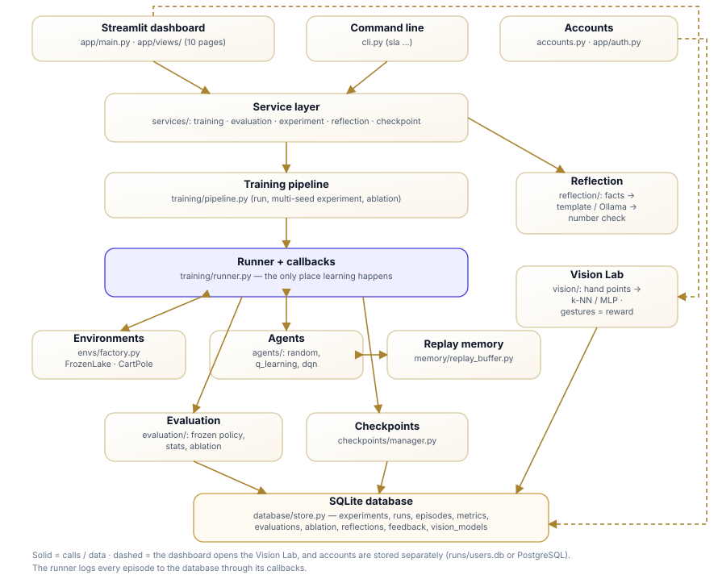

*Figure 1 — System architecture. Every box is a real folder or file in `src/sla/`.*

| Layer | Folder / file | Job |
|---|---|---|
| Website | `app/main.py`, `app/views/` | Ten pages, top navbar, log-in corner |
| Command line | `cli.py` | `sla train`, `pipeline`, `ablation`, `evaluate`, `baseline`, `reflect`, `runs`, `init-db`, `dashboard` |
| Services | `services/` | One entry point per feature (training, evaluation, experiments, reflection, checkpoints) |
| Pipeline | `training/pipeline.py` | Single run, multi-seed experiment, baseline, ablation |
| Runner | `training/runner.py` | The training loop — the only place learning happens |
| Agents | `agents/` | `random_agent.py`, `q_learning.py`, `dqn.py`, `networks.py`, `schedules.py` |
| Environments | `envs/factory.py` | Creates Gymnasium environments with consistent seeding |
| Memory | `memory/replay_buffer.py` | Experience replay for the DQN |
| Evaluation | `evaluation/` | Frozen-policy tests, statistics, ablation summary, plots |
| Checkpoints | `checkpoints/manager.py` | Save, resume, and pick the best checkpoint |
| Reflection | `reflection/` | Facts → note (template or local LLM) → number check |
| Vision Lab | `vision/`, `app/vision_live.py` | Hand points → gesture learner; gestures as rewards |
| Accounts | `accounts.py`, `app/auth.py`, `app/mailer.py` | Log in, sign up, guest mode, remember-me, password reset |
| Storage | `database/store.py` | SQLite database with versioned schema |

*Table 1 — Layers and their real locations.*

**Data flow.** Figure 2 shows one experiment from start to finish. Steps 2–5 write to the database; the website only
reads it, so the website can never change a result.

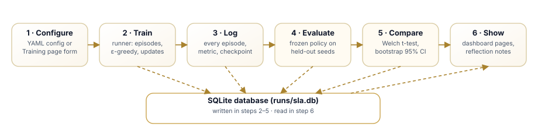

*Figure 2 — Data flow of one experiment.*

<a id="s10"></a>
## 10. Environments

Both games come from **Gymnasium** [4], the standard library of RL environments. `envs/factory.py` creates them and fixes
their seeds.

| | FrozenLake-v1 (4×4) | CartPole-v1 |
|---|---|---|
| Story | Walk across a frozen lake from START to GOAL without falling into a hole | Keep a pole upright on a moving cart |
| State | 1 of 16 squares | 4 numbers: cart position, cart speed, pole angle, pole spin |
| Actions | 4: left, down, right, up | 2: push left, push right |
| Reward | 1 at the goal, otherwise 0 | +1 for every step the pole stays up |
| Episode ends | Goal, hole, or 100 steps | Pole falls, cart leaves the track, or 500 steps |
| Our setting | Non-slippery map (`is_slippery: false` in `configs/frozenlake_qlearning.yaml`) | Standard |
| Agent used | Tabular Q-learning | DQN |
| Why chosen | Small enough to *see* learning in a table | Endless states: needs a neural network |

*Table 2 — The two environments.*

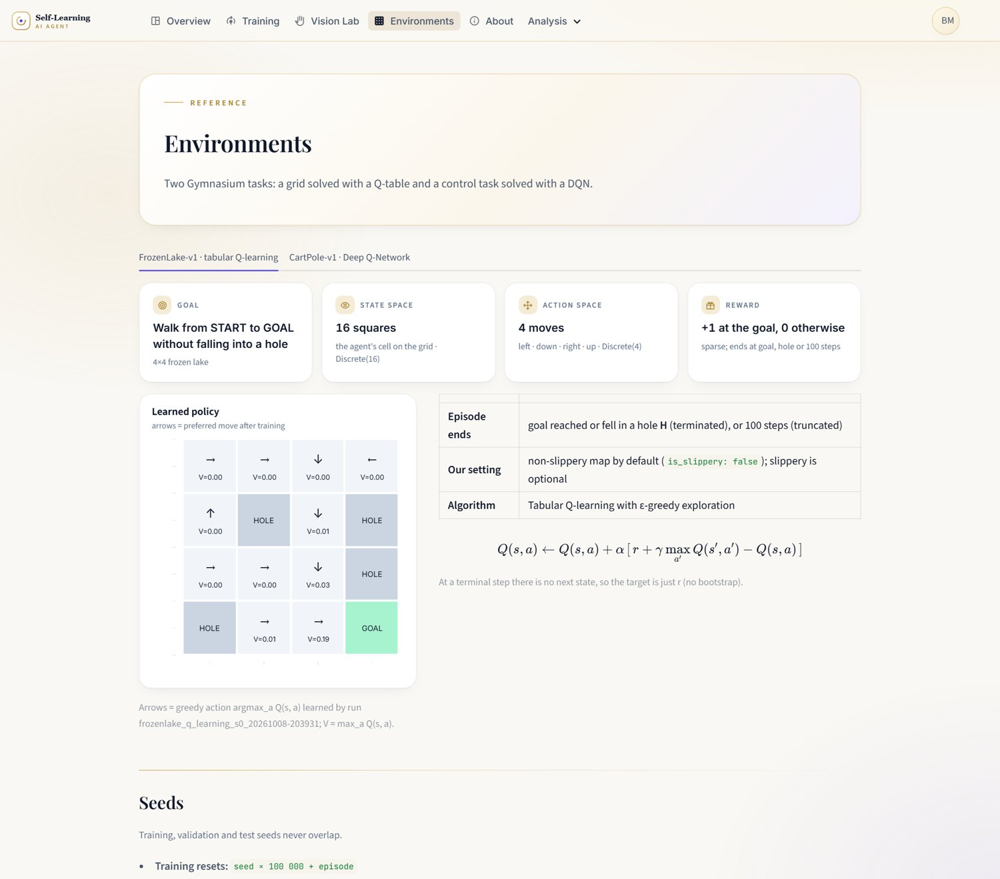

*Figure 3 — Environments page: the learned FrozenLake policy (arrows) from a stored run.*

<a id="s11"></a>
## 11. Agents

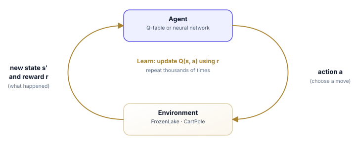

*Figure 4 — The reinforcement-learning loop used by every agent.*

### 11.1 Random baseline (`agents/random_agent.py`)

Picks a random action every step. It never learns. It shows the score you get **with no learning at all**, so it is the
yardstick for every result.

### 11.2 Tabular Q-learning (`agents/q_learning.py`)

The agent keeps a 16 × 4 table of scores, all starting at 0. After every move it applies the Q-learning update:

> `Q(s, a) ← Q(s, a) + α · ( target − Q(s, a) ),  where  target = r  if the episode ended,  otherwise  r + γ · max Q(s′, ·)`

- **α (alpha) = 0.1** — the learning rate: how big each nudge is.
- **γ (gamma) = 0.99** — the discount: how much future reward counts.
- ε falls from 1.0 to 0.05 over 10,000 steps; training lasts 2,000 episodes (`configs/frozenlake_qlearning.yaml`).

> **Worked example.** The agent stands next to the GOAL and moves right. It reaches the goal, so r = 1 and the episode
> ends: target = 1. New score = 0 + 0.1 × (1 − 0) = **0.1**. Later, one square further back, the agent moves towards
> that square: r = 0, and the best score there is now 0.1, so target = 0 + 0.99 × 0.1 = 0.099 and the new score is
> 0 + 0.1 × 0.099 = **0.0099**. Over thousands of games, the reward “flows backwards” from the goal to the start.

### 11.3 Deep Q-Network (`agents/dqn.py`, `agents/networks.py`, `memory/replay_buffer.py`)

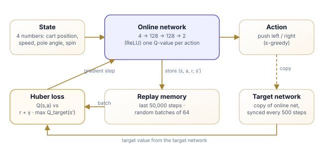

*Figure 5 — How the DQN learns (sizes from `configs/cartpole_dqn.yaml`).*

| Setting | Value | Meaning |
|---|---|---|
| Network | 4 → 128 → 128 → 2, ReLU | `QNetwork` in `networks.py` |
| Optimizer / learning rate | Adam, 0.0005 | How the weights are adjusted |
| Discount γ | 0.99 | Future reward weight |
| ε schedule | 1.0 → 0.05 over 10,000 steps | `LinearSchedule` in `schedules.py` |
| Replay memory | 50,000 moves, batches of 64, learning starts after 1,000 | Experience replay |
| Target network | Copied every 500 gradient steps | Stable targets |
| Loss / gradient clip | Huber (smooth L1), clip 10.0 | Robust to big errors |
| Training length | 600 episodes, max 500 steps each | Per seed |

*Table 3 — DQN hyper-parameters (from `configs/cartpole_dqn.yaml`).*

> **Worked example (one training target).** The agent pushed right and got r = 1. The target network says the best
> Q-value of the next state is 50, so target = 1 + 0.99 × 50 = **50.5**. The online network had predicted 48, so the
> error is 2.5. Huber loss = 2.5 − 0.5 = **2.0** (for errors larger than 1 it grows linearly, so one bad sample cannot
> blow up training). A gradient step then moves the prediction a little towards 50.5.

> **Worked example (ε).** After 5,000 of the 10,000 decay steps: ε = 1.0 − (1.0 − 0.05) × 5,000/10,000 = **0.525**, so
> about half of the moves are still random.

<a id="s12"></a>
## 12. Training pipeline

The pipeline (`training/pipeline.py`) offers four ways to train. All of them use the **runner** (`training/runner.py`),
which plays episodes, asks the agent to learn after each step, and calls **callbacks** for logging, validation,
checkpoints, safety and live charts.

| Mode | Function / command | What happens |
|---|---|---|
| Single run | `train_run` · `sla train` | Train one seed, then test the best checkpoint on held-out seeds |
| Multi-seed experiment | `run_experiment` · `sla pipeline` | 5 seeds: untrained test → train → final test; plus the random baseline; plus statistics |
| Baseline | `run_baseline` · `sla baseline` | Random agent on the same held-out test seeds |
| Ablation | `run_ablation` · `sla ablation` | Full DQN vs no replay vs no target network, 5 seeds each |

*Table 4 — Training modes.*

**Checkpoints.** Every few episodes the agent is saved (`runs/<run_id>/checkpoints/ep_000049/` …). A **validation**
evaluation (20 games on separate validation seeds) runs every 50 episodes (CartPole) or 100 episodes (FrozenLake), and
the best-scoring checkpoint is the one tested at the end. Runs can be resumed from the latest checkpoint.

**Safety.** `training/safety.py` stops runaway runs (too many steps, too much time, broken numbers), and
`training/guards.py` stops training if Q-values or the loss explode and flags drops in validation score.

**Reproducibility.** Every run stores its seed, its full configuration and the git commit (`git_sha`). Training games use
reset seeds `seed × 100,000 + episode`; validation seeds start at **10,000,000** and test seeds at **20,000,000**
(`evaluation/evaluate.py`), so the three sets never overlap.

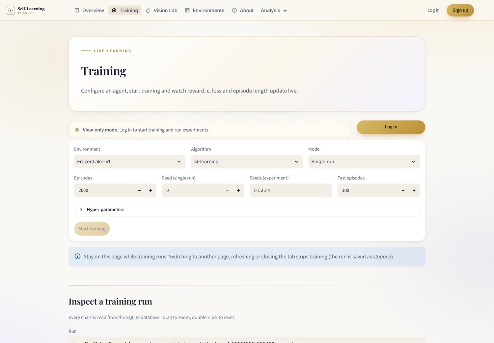

*Figure 6a — Training page for a visitor: the form is visible but view-only.*

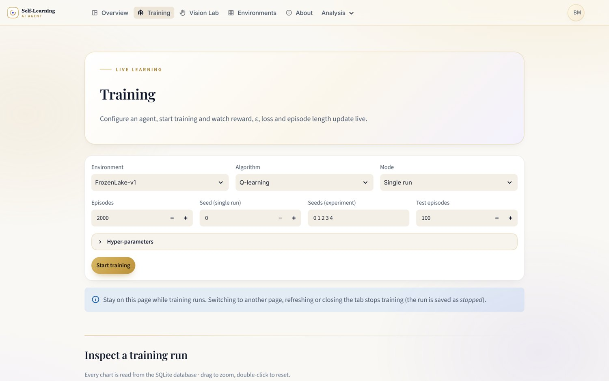

*Figure 6b — Training page for a signed-in member: “Start training” is enabled.*

<a id="s13"></a>
## 13. Evaluation and statistics

**The fair exam.** The agent is frozen (ε = 0, no learning) and plays **100 games** on held-out test seeds. Three
players take the same exam: the **untrained** agent (before learning), the **trained** agent (best checkpoint) and the
**random** player. This is repeated for **5 training seeds** (`evaluation/evaluate.py`, `evaluation/stats.py`).

**Statistics** (`evaluation/stats.py`): mean and standard deviation over the 5 seeds; a bootstrap 95% confidence
interval (10,000 re-samples); Welch’s t-test (SciPy `ttest_ind(equal_var=False)`) for trained − random and trained −
untrained.

**The “LEARNING VERIFIED” rule.** The Evaluation page shows LEARNING VERIFIED only if the trained agent beats **both** the
random player and its own untrained start with **p < 0.05 and a confidence interval entirely above 0**. Otherwise it says
the evidence is insufficient — it never claims learning on weak evidence.

> **Worked example (reading a p-value).** CartPole: trained 425.92 vs random 22.58 over 5 seeds each gives Welch’s
> t = 7.36 and p = 0.0018. In words: if training had no real effect, a gap this large would appear less than 2 times in
> 1,000 repeats. The bootstrap interval of the gain (291.22 to 474.74) is far above 0, so the rule says LEARNING VERIFIED.

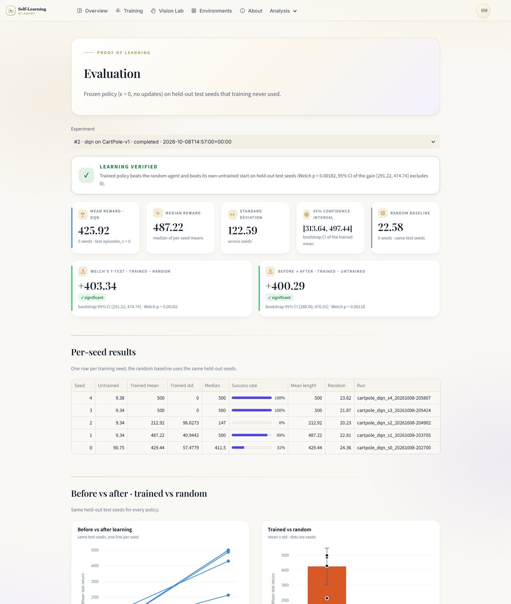

*Figure 7 — Evaluation page with the LEARNING VERIFIED banner and per-seed results.*

<a id="s14"></a>
## 14. Ablation study

**Question:** which DQN parts are really needed? **Method** (`training/pipeline.py`, `evaluation/ablation.py`,
`configs/ablation_*.yaml`): train three variants on CartPole with 5 seeds each, all other settings equal:

1. **Full DQN** — replay memory and target network.
2. **No replay** (`replay_enabled: false`) — learns only from the newest move.
3. **No target network** (`target_net_enabled: false`) — uses the online network for its own targets.

Each variant takes the same held-out test, and the full DQN is compared with each variant using Welch’s t-test and a
bootstrap CI. Results are in Section 20.3.

> **Why each part matters.** Without replay, the network learns from long runs of almost identical moves and forgets
> what it learned before. Without a target network, every update also moves the target it is aiming at, so the values
> chase themselves and learning collapses.

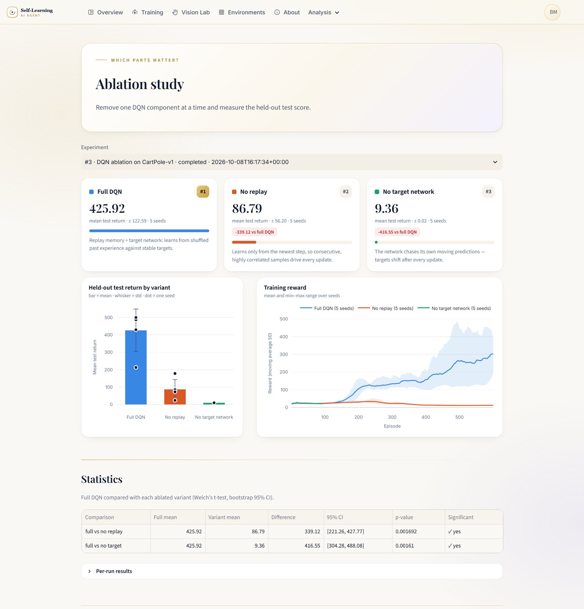

*Figure 8 — Ablation page (real stored results).*

<a id="s15"></a>
## 15. Reflection layer

The reflection layer (`reflection/`) writes a short plain-language note about a run — but it is designed so it **cannot
invent numbers**:

1. **Facts** (`reflection/stats.py`, `compute_facts`): numbers are computed from the stored episodes and evaluations —
   average reward in the first and last 50 episodes, best episode, best validation score, untrained and trained test
   scores, final ε, and so on.
2. **Writing:** either a fixed **template** (`reflection/fallback.py`) or, optionally, a small **local LLM** through
   Ollama (`reflection/llm_client.py`, default model `qwen2.5:1.5b`). Nothing is sent to the internet.
3. **Number check** (`reflection/grounding.py`): every number in the note must match a fact within 1% (small counting
   numbers 0–10 are always allowed). If any number fails, the LLM note is **rejected** and the template note is shown
   instead.
4. **Ratings** (`reflection/feedback.py`): users can rate a note as accurate/useful. Ratings judge the explanation only —
   they never change what the agent learns.

> **Why the LLM never “learns” here.** The language model only describes facts; it does not change the Q-table or the
> network. That is why the project counts it as an explanation tool, not as learning.

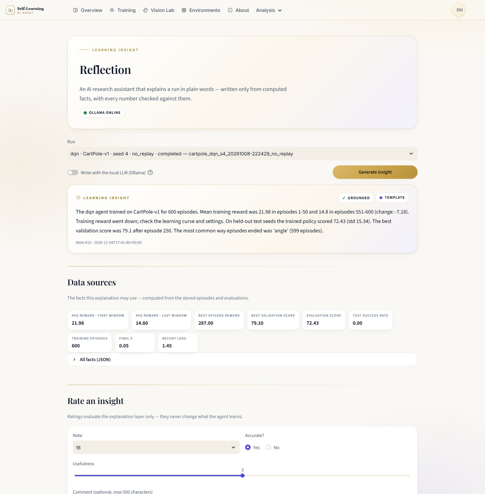

*Figure 9 — Reflection page: a grounded insight and the facts it was allowed to use.*

<a id="s16"></a>
## 16. Database design

All results live in one SQLite file (`runs/sla.db`), managed by `database/store.py`. SQLite needs no server and is built
into Python. The schema is versioned with `PRAGMA user_version`: **version 1** created the experiment tables and
**version 2** (the Vision Lab) added `vision_models`. Old databases are upgraded automatically when opened.

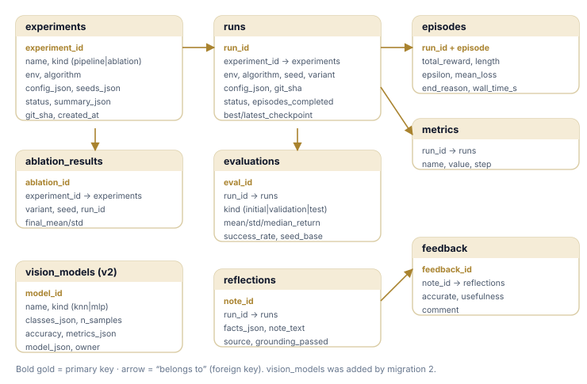

*Figure 10 — Database tables and how they connect.*

| Table | One row is… | Key columns |
|---|---|---|
| `experiments` | a multi-seed experiment or ablation | `kind`, `config_json`, `seeds_json`, `summary_json` (statistics), `git_sha` |
| `runs` | one training run (one seed) | `env`, `algorithm`, `seed`, `variant`, `status`, `best_checkpoint` |
| `episodes` | one game during training | `total_reward`, `length`, `epsilon`, `mean_loss`, `end_reason` |
| `metrics` | a named number for a run | `name`, `value`, `step` |
| `evaluations` | one frozen-policy test | `kind` (initial / validation / test), `mean_return`, `success_rate`, `seed_base` |
| `ablation_results` | one ablation variant × seed | `variant`, `final_mean`, `final_std` |
| `reflections` | one written note | `facts_json`, `note_text`, `source`, `grounding_passed` |
| `feedback` | one rating of a note | `accurate`, `usefulness`, `comment` |
| `vision_models` | a saved gesture model | `kind`, `classes_json`, `accuracy`, `model_json`, `owner` |

*Table 5 — Database tables (accounts are stored separately, see Section 18).*

The committed snapshot `data/demo/sla_demo.db` contains **3 experiments, 36 runs, 20,314 episodes and 344 evaluations**
(11 initial, 296 validation, 37 test). The live website loads it on first start so visitors can see real results.


<a id="s17"></a>
## 17. The website (dashboard)

The website is built with **Streamlit** [5] (it turns Python into web pages) and **Plotly** (interactive charts). The
entry point is `src/sla/app/main.py`; each page is a file in `app/views/`. Every number on every page is read from the
database — the website never computes a result on its own, and an empty section says **NOT RUN** instead of showing a
made-up value.

**Navigation.** A sticky top navbar shows **Overview · Training · Vision Lab · Environments · About** and an
**Analysis ▾** menu (Agent comparison, Evaluation, Ablation, Run explorer, Reflection). The top-right corner holds
**Log in** and **Sign up**, or the signed-in user’s avatar (Section 18).

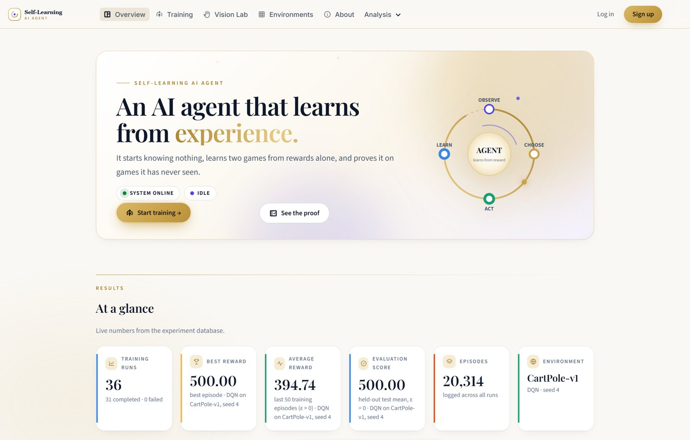

*Figure 11 — Overview: hero with the animated learning loop and live numbers from the database.*

| Page (file) | What you see | What it means |
|---|---|---|
| Overview (`overview.py`) | Hero, live numbers, how it works, features, newest run, proof table, architecture, team, FAQ | A quick tour and health check |
| Training (`training.py`) | Form + live reward, ε, loss and episode-length charts | Start learning and watch it happen (members) |
| Vision Lab (`vision.py`) | Webcam / uploads, live prediction, gesture rewards, results | The agent learns from a person (Section 19) |
| Environments (`environment.py`) | Game cards and the learned FrozenLake map | What the agent sees and does |
| About (`about.py`) | Objective, architecture diagram, stack, limits, team | Background |
| Agent comparison (`comparison.py`) | Ranked cards: trained vs random, charts | Which agent is best, by how much |
| Evaluation (`evaluation.py`) | LEARNING VERIFIED banner, statistics, per-seed table | The proof (Section 13) |
| Ablation (`ablation.py`) | Full vs no replay vs no target network | Which DQN parts matter (Section 14) |
| Run explorer (`explorer.py`) | One run’s curves, config, tests, checkpoints, logs, share link | Full history of a run |
| Reflection (`reflection.py`) | Grounded insight, facts, ratings | Explanation in words (Section 15) |

*Table 6 — Website pages.*

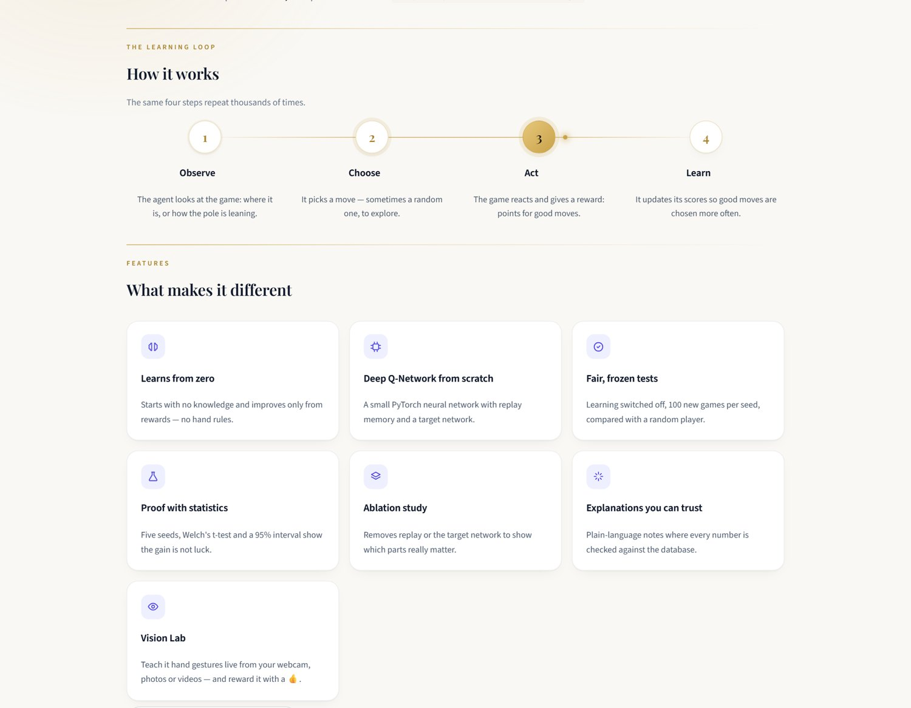

*Figure 12 — Overview: how it works (four animated steps) and the feature cards.*

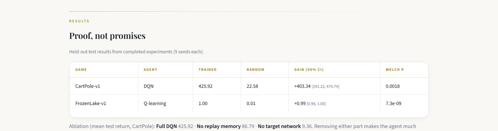

*Figure 13 — Overview: the proof table, filled from the stored experiment summaries.*

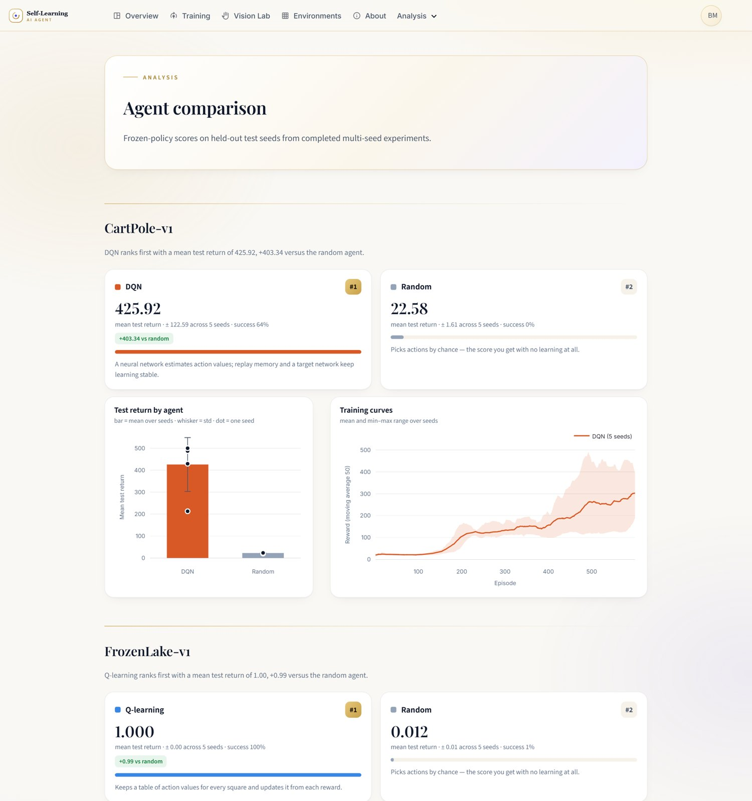

*Figure 14 — Agent comparison page.*

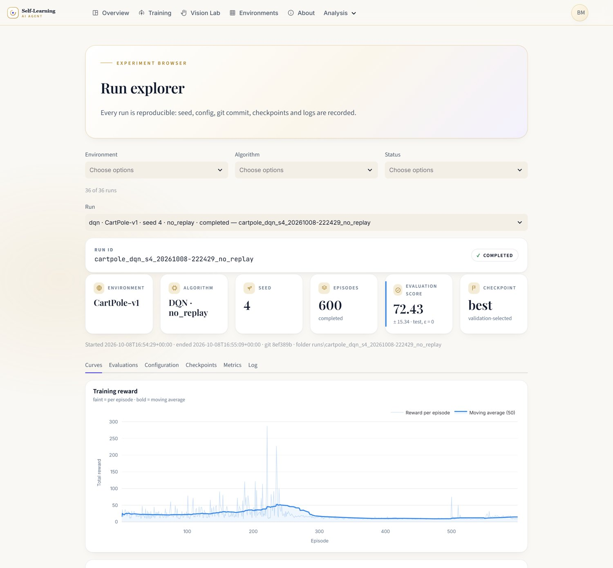

*Figure 15 — Run explorer with its view-only “Share this run” link (bottom).*

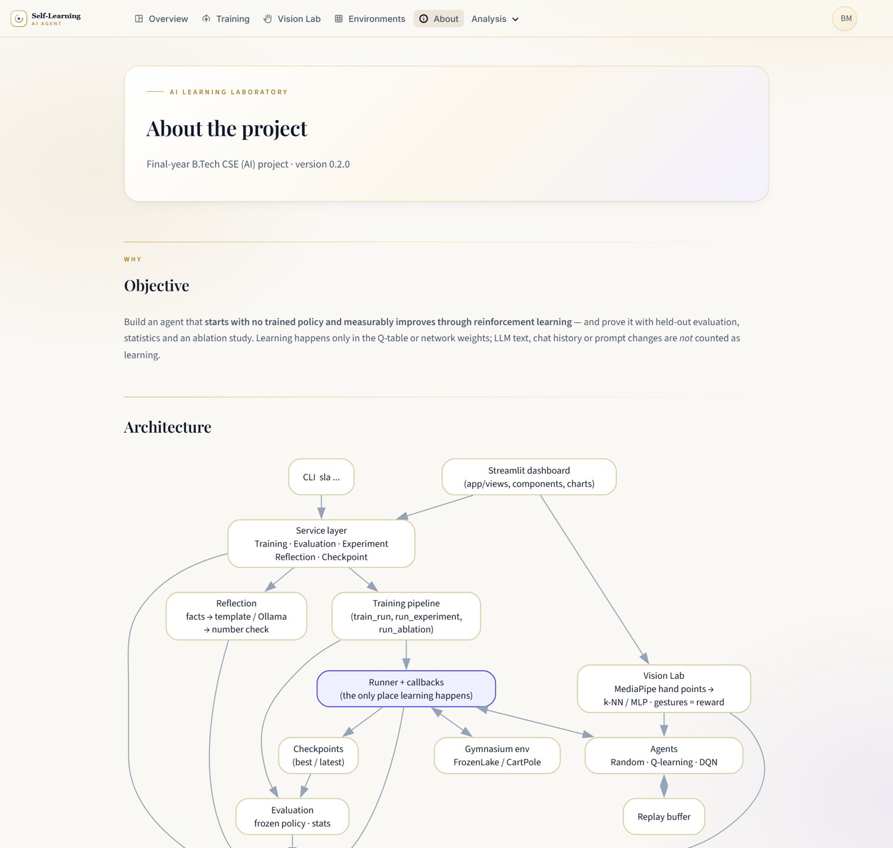

*Figure 16 — About page: objective, the full architecture diagram, stack and limits.*

**Design system** (`app/styles/theme.py`). Colours are CSS variables: ivory `#FAF8F4` background, ink `#0F172A`
headings, slate `#475569` text, champagne gold `#C9A24B` accents and indigo `#4F46E5` used sparingly. Headings use
Playfair Display, body text uses Inter, cards are white with 18 px corners, soft shadows and gold hairlines. Motion is
CSS only: fade-up, hover lift, button shine, a word-by-word hero headline, an animated learning loop and count-up
numbers. Everything turns off when the device asks for **reduced motion** (`prefers-reduced-motion`). The layout works
down to phone width (Figure 17).

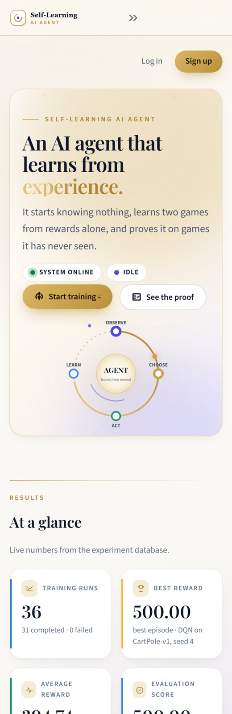

*Figure 17 — Phone view of the Overview (390 px wide).*

<a id="s18"></a>
## 18. Accounts and security

Anyone can open every page and see every result. Logging in only unlocks actions that **change** something.

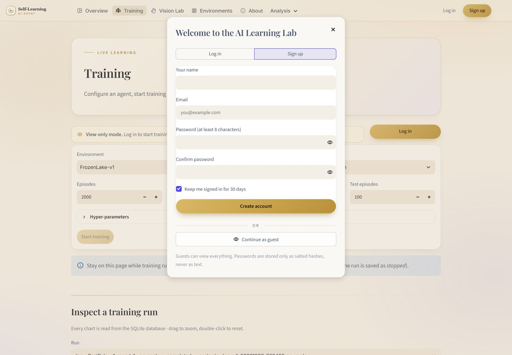

*Figure 18a — The Log in / Sign up dialog opened from the top-right corner.*

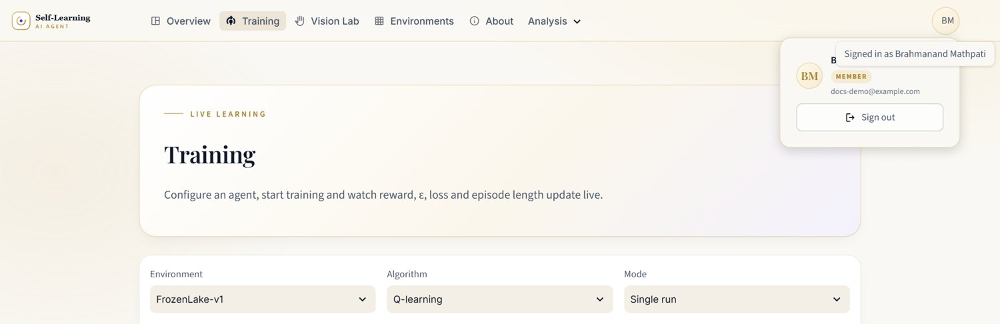

*Figure 18b — Signed-in avatar menu with the role badge and Sign out.*

| Action | Visitor | Guest | Member (email or Google) |
|---|---|---|---|
| View every page, chart and result | ✓ | ✓ | ✓ |
| Open a shared run link | ✓ | ✓ | ✓ |
| Try the Vision Lab camera and predictions | ✓ | ✓ | ✓ |
| Start training / run experiments | — | — | ✓ |
| Generate and rate reflection notes | — | — | ✓ |
| Save Vision Lab sessions and gesture models | — | — | ✓ |

*Table 7 — What each role can do (`auth.can_act()` and `auth.member_gate()` in `app/auth.py`).*

**How passwords are kept safe** (`accounts.py`):

- Passwords are **never stored**. Each is turned into a **salted PBKDF2-SHA256 hash** with 200,000 rounds; only the hash
  and a random 16-byte salt are saved. Two people with the same password get different hashes.
- Checking a wrong email takes the same time as a wrong password, so the timing does not reveal who has an account.
- **Keep me signed in** stores a random 256-bit token in a 30-day cookie; only its SHA-256 hash is in the database, and
  signing out deletes it.
- **Forgot password** emails a **single-use** link that expires after 30 minutes (needs `[smtp]` settings). The reply is
  the same whether or not the email exists. Resetting a password signs the account out on every device.
- **Google sign-in** uses Streamlit’s built-in `st.login` and appears only when `[auth]` secrets exist.
- Accounts live in their own file (`runs/users.db`, never committed) or, optionally, in a PostgreSQL database such as
  Supabase (`[accounts] url`). If that database cannot be reached, the app falls back to the local file.
- **Share this run** gives a view-only link like `…/runs?run=<run_id>` (Figure 15).

> **Worked example (why salt matters).** If two users both choose “sunshine123”, a plain hash would be identical for
> both, so cracking one cracks the other. With a random salt per user, the stored hashes differ, and an attacker has to
> attack each one separately — 200,000 hashing rounds each time.

<a id="s19"></a>
## 19. Vision Lab: learning from photos, videos and live gestures

The Vision Lab (`app/views/vision.py`, `app/vision_live.py`, `vision/`) lets a person **teach the agent hand gestures**
and then **reward the RL agent with gestures**.

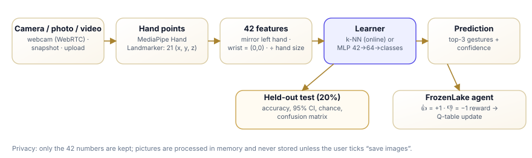

*Figure 19 — Vision Lab pipeline.*

### 19.1 From a picture to 42 numbers (`vision/hands.py`, `vision/features.py`)

MediaPipe’s Hand Landmarker finds 21 points on the hand (the model file, about 7.8 MB, is downloaded once into
`runs/models/`). Then `normalise()` turns them into **42 numbers** that describe the hand’s **shape**:

1. If it is a left hand, mirror it so it looks like a right hand.
2. Move the wrist to (0, 0) — this removes *where* the hand is in the picture.
3. Divide by the hand size (wrist → middle-finger knuckle distance) — this removes *how big* the hand looks.
4. Keep x and y of the 21 points → 42 numbers.

> **Worked example.** Wrist at (0.50, 0.80), middle knuckle at (0.50, 0.60) → hand size 0.20. A fingertip at
> (0.55, 0.40) becomes ((0.55 − 0.50) / 0.20, (0.40 − 0.80) / 0.20) = **(0.25, −2.0)**. The same hand closer to the
> camera gives the same numbers.

### 19.2 Two learners (`vision/learners.py`)

- **k-NN (online):** stores every sample and predicts by looking at the 5 nearest stored samples (closer ones count
  more). It learns **instantly** from each new sample. *Example:* if 4 of the 5 nearest samples are 👍 and one is ✊, it
  predicts 👍 with about 80% confidence.
- **Small neural network:** 42 → 64 → number of classes, trained with Adam when the user presses **Train**.

### 19.3 Honest measurement

Accuracy is always measured on a **held-out 20%** of the samples (stratified, fixed seed) that the learner never saw,
with a **bootstrap 95% CI**, the **chance level** (1 ÷ number of classes), a **confusion matrix** and a **learning curve**
(accuracy as more samples are learned). With fewer than 10 samples for at least two classes the page shows **NOT RUN**.

### 19.4 The four tabs

1. **Teach with gestures:** live webcam (WebRTC) with the skeleton drawn on every frame, or camera snapshots. Pick a
   class (👍 👎 ✋ ✊ by default) and record samples (at most 5 per second).
2. **Photos and videos:** upload images or videos (≤ 30 s, sampled at 5 frames per second, `vision/video.py`) to add
   samples, or test on a new file with a frame-by-frame prediction timeline.
3. **Gestures teach the agent** (`vision/human_rl.py`): FrozenLake proposes a move; 👍 gives +1, 👎 gives −1, ✋ pauses,
   ✊ resets. The Q-table learns from the **human** reward: Q(s, a) ← Q(s, a) + α · (r_human + γ · max Q(s′) − Q(s, a)),
   with α = 0.5 and γ = 0.9. Sessions are saved as runs with `variant = "human_feedback"`.
4. **Results and model card:** real metrics, limits and privacy notes; members can save, load, delete and export models.

> **Worked example (human reward).** The agent proposes “left” at the start, where Q = 0. The user shows 👎 (r = −1).
> New Q = 0 + 0.5 × (−1 + 0.9 × 0 − 0) = **−0.5**, so next time “left” is less likely to be chosen there.

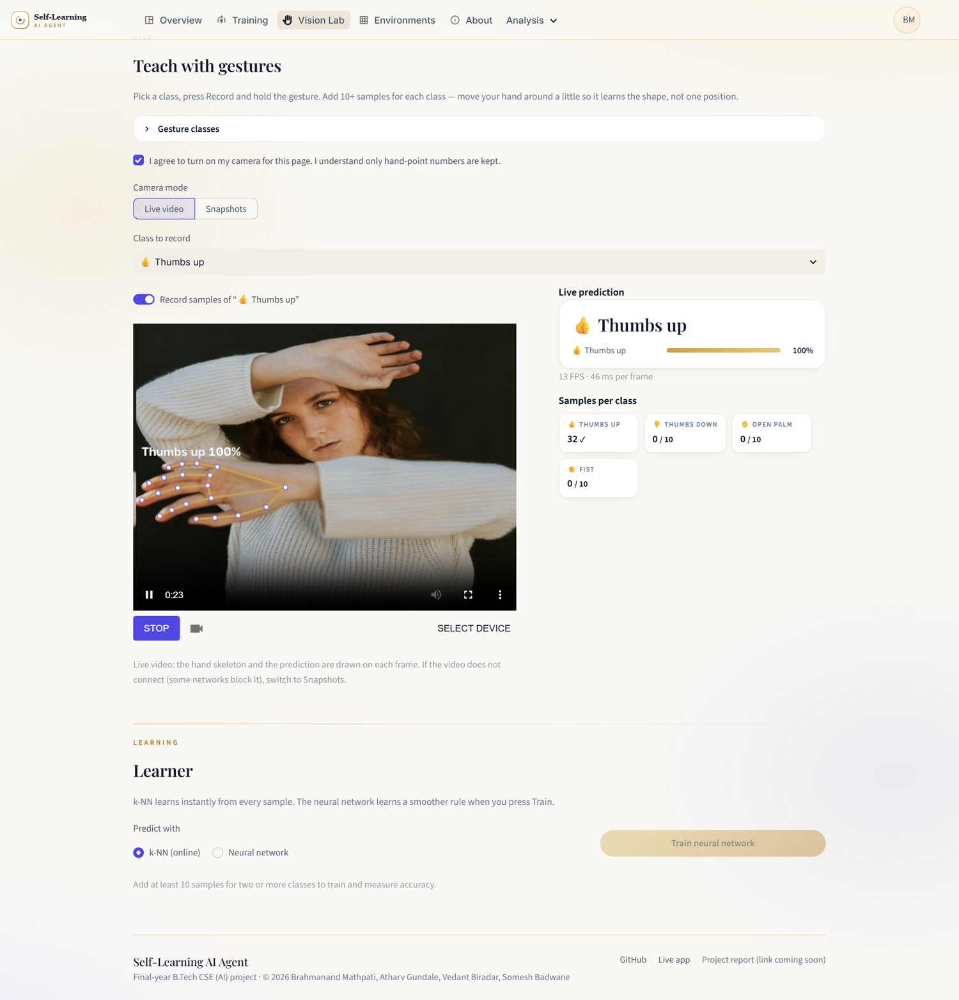

*Figure 20 — Teach with gestures: live video with the 21-point skeleton, live prediction and sample counters. (For this
screenshot the browser’s camera was fed Google’s public MediaPipe sample photo, because the documentation laptop has no
webcam.)*

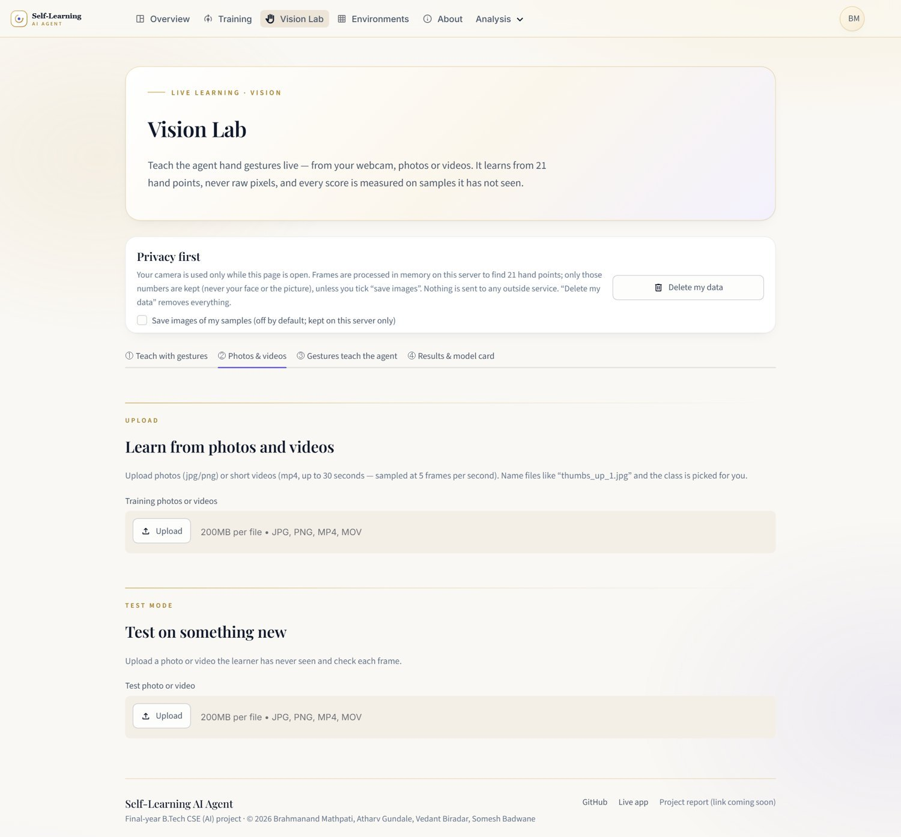

*Figure 21 — Photos and videos tab.*

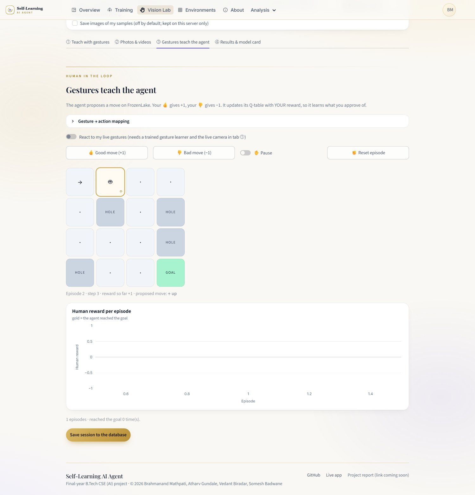

*Figure 22 — Gestures teach the agent: the FrozenLake board, proposed move and reward chart.*

### 19.5 Privacy and limits

- The camera starts only after a **consent** tick. Frames are processed in memory; only the 42 numbers are kept (no faces
  or pictures unless “save images” is ticked). **Delete my data** removes the samples, saved images and the member’s
  saved models. Nothing is sent to an outside service.
- One hand at a time. Poor light, motion blur and very close-ups (where the palm fills the picture) make detection fail —
  we saw MediaPipe miss the thumb on a close-up photo during testing.
- A model trained on one person may not work as well for others; accuracy across people and skin tones is unknown until
  it is tested with samples from several people.
- Live video on Streamlit Community Cloud usually needs a **TURN** relay server (`[webrtc]` secrets). Without it,
  snapshots, photos and videos still work.


# Part C — Proof

<a id="s20"></a>
## 20. Results

All values in this section come from the committed results database `data/demo/sla_demo.db` (experiment summaries and
evaluations) and the exported tables in `results/`. Each experiment used 5 training seeds and 100 frozen-policy test games
per seed on held-out test seeds.

### 20.1 FrozenLake — Q-learning (experiment 1)

| Player | Test success rate (mean of 5 seeds) | Per seed |
|---|---|---|
| Random | 0.012 | 0.00, 0.03, 0.01, 0.02, 0.00 |
| Untrained Q-learning | 0.012 | 0.00, 0.03, 0.01, 0.02, 0.00 |
| **Trained Q-learning** | **1.000** | 1.00, 1.00, 1.00, 1.00, 1.00 |

*Table 8 — FrozenLake held-out test results.*

Trained − random = **+0.988** (bootstrap 95% CI 0.978 to 0.998), Welch’s t = 169.44, **p < 0.001**.
**In plain words:** before learning, the agent (like a random player) reached the goal in about 1 of 100 games; after
2,000 practice games it reached the goal in every test game, for every seed.

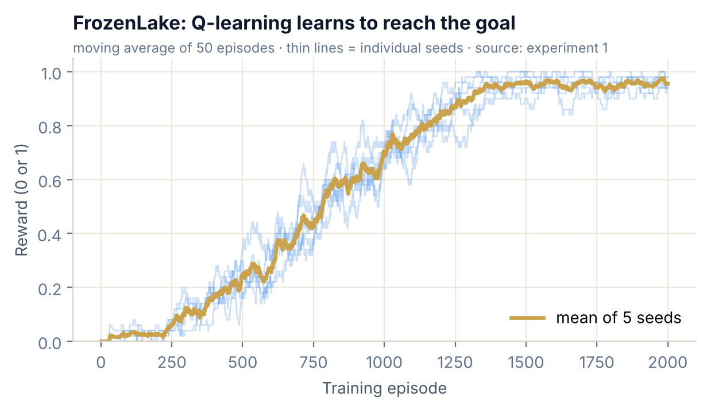

*Figure 23 — FrozenLake learning curves (experiment 1). Training reward rises from 0 to almost 1 between episodes 250 and
1,500. Training reward stays slightly below 1 because the agent still explores (ε = 0.05); the frozen test has ε = 0.*

### 20.2 CartPole — DQN (experiment 2)

| Player | Mean test steps balanced (of 500) | Std over seeds | Per seed |
|---|---|---|---|
| Random | 22.58 | 1.61 | 24.36, 22.81, 20.23, 21.87, 23.62 |
| Untrained DQN | 25.63 | — | 90.75, 9.34, 9.34, 9.34, 9.38 |
| **Trained DQN** | **425.92** | **122.59** | 429.44, 487.22, 212.92, 500.00, 500.00 |

*Table 9 — CartPole held-out test results. Test success rate (reaching 500 steps) of the trained DQN: 0.64.*

| Comparison | Gain | Bootstrap 95% CI | Welch’s t | p-value |
|---|---|---|---|---|
| Trained − random | **+403.34** | 291.22 to 474.74 | 7.36 | **0.0018** |
| Trained − untrained | **+400.29** | 288.00 to 476.55 | 7.00 | **0.0012** |

*Table 10 — CartPole statistics. The trained mean’s own 95% CI is 313.64 to 497.44.*

**In plain words:** a random player keeps the pole up for about 23 steps. After 600 practice games the DQN keeps it up
for about 426 steps on games it never saw; two of the five seeds reached the 500-step maximum every time. The weakest
seed scored 212.92, which is why the spread is wide — Section 28 discusses this. Both comparisons pass the LEARNING
VERIFIED rule (p < 0.05 and CI above 0).

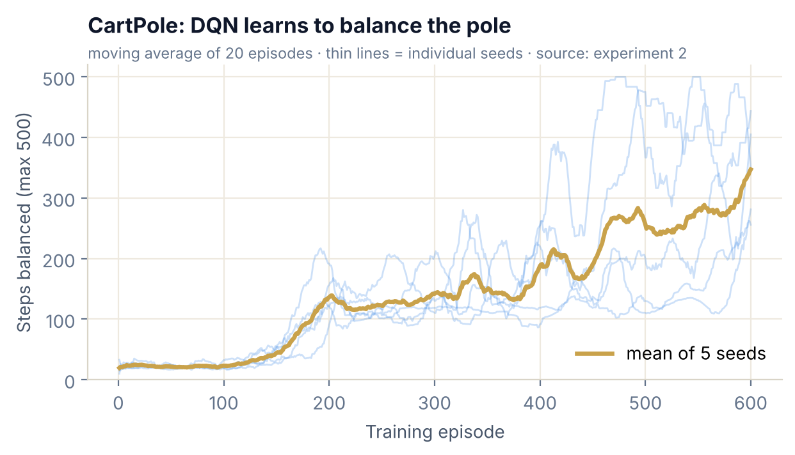

*Figure 24 — CartPole learning curves (experiment 2). The curves are noisy and still rising at episode 600; the test uses
the best validation checkpoint, which is why the test score (425.92) is higher than the final training average.*

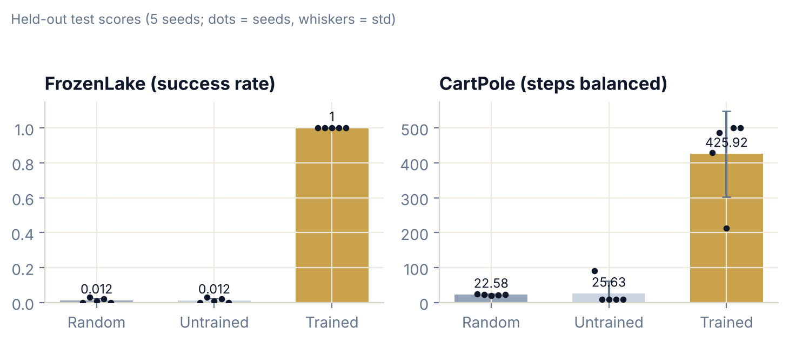

*Figure 25 — Held-out test scores for both games (bars = mean, dots = seeds, whiskers = standard deviation).*

### 20.3 Ablation (experiment 3)

| Variant | Mean test return | Std | Seeds |
|---|---|---|---|
| **Full DQN** | **425.92** | 122.59 | 5 |
| No replay memory | 86.79 | 56.20 | 5 |
| No target network | 9.36 | 0.02 | 5 |

*Table 11 — Ablation results (CartPole).*

| Comparison | Difference | Bootstrap 95% CI | Welch’s t | p-value |
|---|---|---|---|---|
| Full − no replay | +339.12 | 221.26 to 427.77 | 5.62 | 0.0017 |
| Full − no target network | +416.55 | 304.28 to 488.08 | 7.60 | 0.0016 |

*Table 12 — Ablation statistics.*

**In plain words:** removing replay memory loses about 80% of the score; removing the target network loses almost all of
it (9.36 steps is worse than a random player). Both parts are necessary, and both differences are significant.

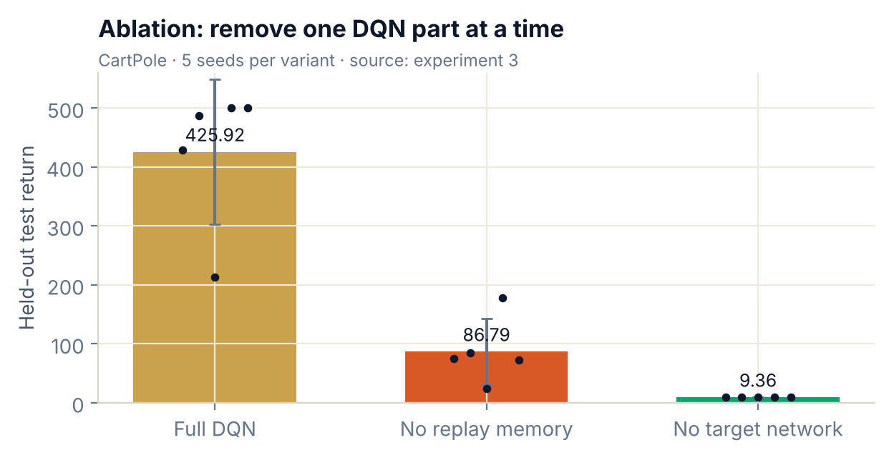

*Figure 26 — Ablation results (bars = mean, dots = seeds).*

<a id="s21"></a>
## 21. Vision Lab results

**Gesture accuracy on the team’s own recorded gestures: NOT MEASURED YET.** No real gesture recordings were made for this
document, and we do not report invented numbers. What *was* measured during development:

| Check | Result | How it was measured |
|---|---|---|
| Hand detection on a photo | about **20–25 ms** per image | `HandDetector.detect()` on the documentation laptop’s CPU (Intel UHD graphics, no GPU used) |
| Landmarks line up with the hand | correct | Drawn skeleton checked by eye on Google’s public MediaPipe sample photo |
| Live video pipeline end to end | works; **5–6 frames per second** | Headless Chrome with a fake camera playing the sample photo; the browser, video encoding and the app shared one laptop CPU. This is below the 15 FPS target and should be re-measured with a real webcam |
| Close-up photo | thumb landmarks wrong | A close-up thumbs-up photo where the palm fills the frame (a known MediaPipe limit) |
| Learner maths on synthetic data | k-NN and MLP far above chance; random labels stay near chance | Unit tests in `tests/unit/test_vision.py` |

*Table 13 — Vision Lab checks that were actually performed.*

**How to measure gesture accuracy (10 minutes):**

1. Open **Vision Lab** on a computer with a webcam and tick the consent box.
2. In tab ①, record **at least 30 samples** for each of 👍 👎 ✋ ✊, moving the hand a little between samples. Ask two or
   three other people to add samples too.
3. Open tab ④. Record the k-NN and neural-network accuracy, the 95% CI, the chance level (25% for 4 classes), the
   confusion matrix and the learning curve.
4. In tab ②, upload a short video of a different person doing the gestures and check the prediction timeline.
5. Replace this section’s “NOT MEASURED YET” with those numbers.

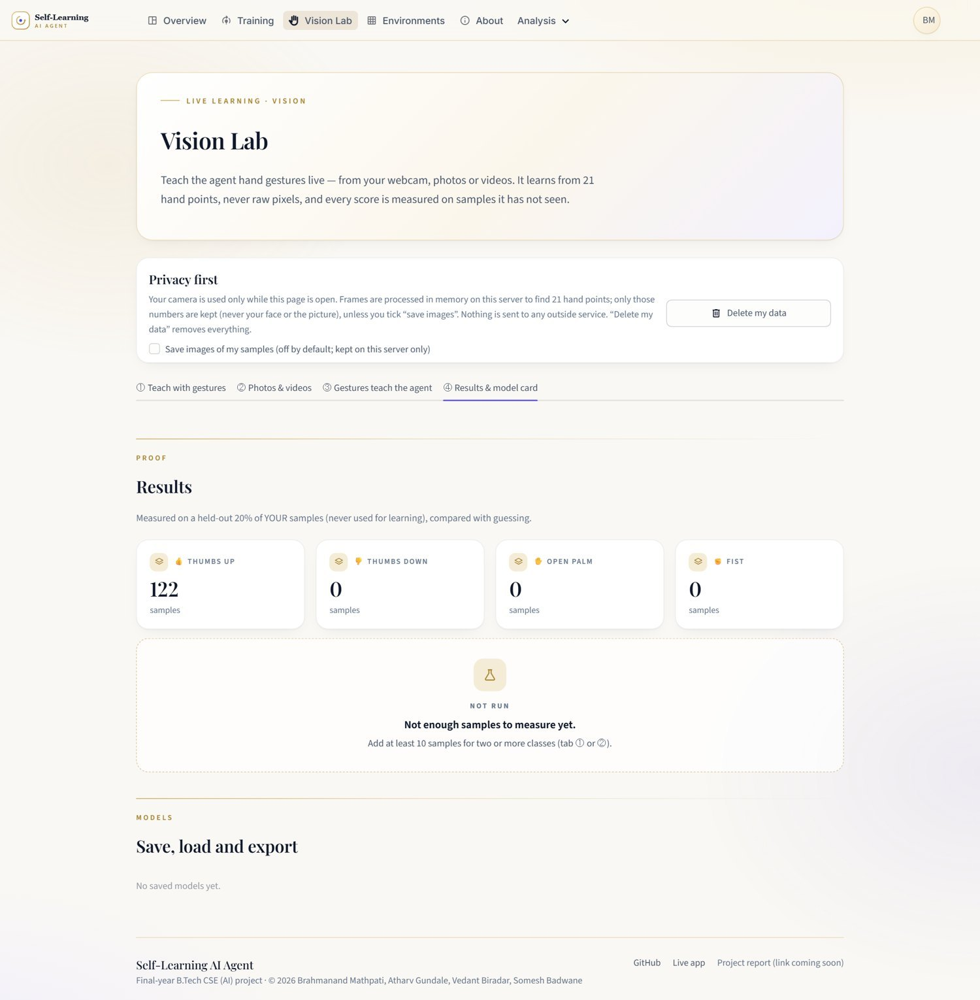

*Figure 27 — Results tab before enough samples exist: it shows NOT RUN instead of a score.*

<a id="s22"></a>
## 22. Testing and quality

| Suite | Folder | Files | Tests | What it covers |
|---|---|---|---|---|
| Unit | `tests/unit/` | 26 | 162 | Agents, Q-learning update, DQN, replay buffer, schedules, environments, statistics, evaluation, database (incl. `vision_models`), accounts and tokens, reflection and grounding, Vision Lab features, learners, video sampling, human-feedback RL |
| Integration | `tests/integration/` | 7 | 20 | CLI commands, pipeline runs end to end, checkpoint resume |
| UI | `tests/ui/` | 3 | 38 | Every page renders (empty and with data), log in / sign up / guest, reset links, share links, Vision Lab gating |
| **Total** | | **36** | **220** | |

*Table 14 — Automated tests (counted with `pytest --collect-only`).*

- **Linting:** `ruff check .` (style and common bugs, line length 120).
- **Continuous integration** (`.github/workflows/`): on every pull request and push to `main`, GitHub Actions installs
  CPU PyTorch on Python 3.11, runs ruff, runs the test suite (except the smoke test), then runs one short smoke training
  run.
- **Run them yourself:** `pytest -q` (all) · `pytest -m "not smoke"` (fast) · `ruff check .`

# Part D — Using and running it

<a id="s23"></a>
## 23. Installation and running locally

**Requirements:** Python 3.10 or newer (CI uses 3.11; the documentation laptop uses 3.13), about 2 GB of free disk space, no GPU needed.

**Windows (PowerShell)**

```
git clone https://github.com/brahmanandmathpati/Self-Learning-AI-Agent.git
cd Self-Learning-AI-Agent
python -m venv .venv
.venv\Scripts\pip install -r requirements.txt
.venv\Scripts\pip install -e ".[dev,vision]"
.venv\Scripts\sla init-db
.venv\Scripts\streamlit run src/sla/app/main.py
```

**Linux / macOS**

```
git clone https://github.com/brahmanandmathpati/Self-Learning-AI-Agent.git
cd Self-Learning-AI-Agent
python3 -m venv .venv && source .venv/bin/activate
pip install -r requirements.txt && pip install -e ".[dev,vision]"
sla init-db
streamlit run src/sla/app/main.py
```

**Train from the command line**

```
sla train    --config configs/frozenlake_qlearning.yaml
sla pipeline --config configs/cartpole_dqn.yaml --seeds 0 1 2 3 4
sla ablation --config configs/cartpole_dqn.yaml --seeds 0 1 2 3 4
sla reflect  --run <run_id>
```

The `[vision]` extra installs MediaPipe and streamlit-webrtc; without it the Vision Lab page explains what to install.

<a id="s24"></a>
## 24. Deployment on Streamlit Community Cloud

1. Push the repository to GitHub and create an app on Streamlit Community Cloud with main file `src/sla/app/main.py`.
2. Cloud installs `requirements.txt` (CPU PyTorch wheels are linked directly per Python version) and the system packages in
   `packages.txt` (`libgl1`, `libglib2.0-0`, needed by OpenCV for the Vision Lab).
3. Optional features are switched on by **Secrets** (App → Settings → Secrets). The values below are placeholders only:

```
[auth]        # "Continue with Google"
redirect_uri = "https://<your-app>.streamlit.app/oauth2callback"
cookie_secret = "<long random string>"
client_id = "<id>.apps.googleusercontent.com"
client_secret = "<secret>"
server_metadata_url = "https://accounts.google.com/.well-known/openid-configuration"

[accounts]    # keep accounts in PostgreSQL (e.g. Supabase) so they survive restarts
url = "postgresql://<user>:<password>@<host>:6543/postgres"

[smtp]        # "Forgot password?" emails
host = "smtp.gmail.com"
port = 587
username = "<you@gmail.com>"
password = "<app password>"
sender = "Self-Learning AI Agent <you@gmail.com>"
app_url = "https://<your-app>.streamlit.app/"

[webrtc]      # live webcam video through a TURN relay
cloudflare_key_id = "<turn key id>"
cloudflare_api_token = "<turn api token>"
```

| Error seen during the project | Cause | Fix in the code |
|---|---|---|
| `ModuleNotFoundError: No module named 'sla'` | Cloud runs the script without installing the package | `main.py` adds `src/` to `sys.path` |
| “Error installing requirements” (PyTorch) | The default PyTorch download is very large / needs an extra index | Direct CPU wheel URLs per Python version in `requirements.txt` |
| Live site showed no results | The cloud disk starts empty | `app/demo_seed.py` loads the committed snapshot on first start |
| `libGL.so.1` import error (OpenCV) | Missing system library | `packages.txt` |
| Webcam video does not connect | Cloud networks block direct WebRTC | `[webrtc]` TURN secrets; snapshots as fallback |
| Accounts disappear after a restart | Cloud disk is wiped on restart | `[accounts] url` (PostgreSQL) |

*Table 15 — Deployment problems and their fixes.*

<a id="s25"></a>
## 25. User guide: the first 10 minutes

**As a visitor (no account)**

1. Open the Overview: read the hero, the live numbers and the proof table (Figures 11–13).
2. Open **Analysis ▾ → Evaluation** to see LEARNING VERIFIED and the per-seed table (Figure 7).
3. Open **Ablation** to see why replay and the target network matter (Figure 8).
4. Open **Run explorer**, pick a run, and copy its share link (Figure 15).

**As a guest** — press **Log in → Continue as guest**. You see the same pages with a “Guest · view only” badge.
Buttons that change data show a short “View-only mode” note with a Log in button.

**As a member**

1. Press **Sign up** (top-right), enter name, email and a password of at least 8 characters; leave “Keep me signed in”
   ticked.
2. Open **Training**, choose FrozenLake + Q-learning + Single run, press **Start training** and watch the live charts (it
   finishes in under a minute on a laptop CPU).
3. Open **Reflection**, pick the new run and press **Generate insight**.
4. Open **Vision Lab**, tick consent, record gestures, and try **Gestures teach the agent**.

<a id="s26"></a>
## 26. Folder structure

```
Self-Learning-AI-Agent/
├── src/sla/
│   ├── agents/        random_agent, q_learning, dqn, networks (QNetwork), schedules (ε)
│   ├── envs/          factory.py — Gymnasium environments with seeding
│   ├── memory/        replay_buffer.py — experience replay
│   ├── training/      runner (training loop), pipeline, config, callbacks, guards, safety
│   ├── evaluation/    evaluate (frozen policy), stats (t-test, bootstrap), ablation, metrics, plots
│   ├── checkpoints/   manager.py — save / resume / best checkpoint
│   ├── reflection/    stats (facts), fallback (template), llm_client (Ollama), grounding, feedback, reflect
│   ├── vision/        hands (MediaPipe), features (42 numbers), learners (k-NN, MLP), video, human_rl
│   ├── database/      store.py — SQLite schema v2 and all queries
│   ├── services/      training, evaluation, experiment, reflection, checkpoint services
│   ├── utils/         errors, logging, seeding, validation, summaries
│   ├── app/           main.py, views/ (10 pages), components/, charts/, styles/theme.py,
│   │                  auth.py, mailer.py, routes.py, vision_live.py, data.py, demo_seed.py
│   ├── accounts.py    accounts, password hashes, remember-me and reset tokens
│   ├── cli.py         the `sla` command
│   └── settings.py    paths (database, configs, runs)
├── configs/           YAML experiment settings (FrozenLake, CartPole, ablations, baselines)
├── data/demo/         committed results snapshot (sla_demo.db, snapshot.json)
├── results/           exported tables (experiments, comparison, ablation)
├── tests/             unit/, integration/, ui/ — 220 tests
├── docs/              this documentation, the Complete Guide and topic notes
├── .streamlit/        config.toml (theme), secrets.toml.example
├── requirements.txt   packages for Streamlit Cloud
├── packages.txt       system packages for Streamlit Cloud (OpenCV)
└── pyproject.toml     package metadata, extras [dev] and [vision], ruff settings
```


# Part E — Reflection

<a id="s27"></a>
## 27. Challenges and how we solved them

| Challenge | What happened | How we solved it |
|---|---|---|
| Proving learning honestly | Training scores include exploration, so they overstate or understate skill | Frozen-policy tests on held-out seeds, 5 training seeds, untrained and random baselines, statistics and the LEARNING VERIFIED rule |
| DQN instability | Without care, Q-values and loss can explode | Huber loss, gradient clipping, target network, `training/guards.py` divergence guard |
| Deployment on Streamlit Cloud | `No module named 'sla'`, PyTorch install failures, an empty database | `sys.path` bootstrap, direct CPU wheel URLs, committed demo snapshot (Table 15) |
| Live chart mixing runs | The live training panel showed points from an earlier seed | The panel resets for each new `run_id` |
| Training stopped when leaving the page | Streamlit stops a script when the user navigates away | A clear warning on the Training page; the run is saved as *stopped* and can be resumed |
| Streamlit loaded unwanted pages | A folder named `pages/` is auto-loaded by Streamlit | Renamed to `views/` |
| Sign-in lost after clicking a button | Plain HTML links reload the page, which starts a new session | Session-safe links with `st.page_link` (`app/routes.py`) and a remember-me cookie |
| Dialog did not re-open in tests | Dialogs re-run only inside a real browser | The open dialog is kept in session state |
| A hard-to-read button | Streamlit names form buttons differently (`primaryFormSubmit`) | Extra CSS selector and dark text on gold |
| MediaPipe API change | The old `solutions.hands` API is gone in MediaPipe 1.x | The Tasks `HandLandmarker` with a one-time model download |
| OpenCV on the cloud | Missing `libGL` system library | `packages.txt` |

*Table 16 — Real problems met during the project.*

<a id="s28"></a>
## 28. Limitations and future work

**Limitations (honest):**

- Two small benchmark games. This is bounded, single-task learning — not general intelligence.
- Five seeds give wide confidence intervals; the CartPole DQN is sensitive to hyper-parameters (one seed scored 212.92
  while two reached 500), and results can vary across hardware.
- The LLM in the reflection layer only explains results; it never learns, and it is optional.
- Vision Lab accuracy on real users is **not measured yet**; the live video ran at 5–6 FPS in our fake-camera test, below
  the 15 FPS target, and needs a TURN server on the cloud.
- On Streamlit Community Cloud, accounts stored in the local file disappear when the app restarts unless a PostgreSQL
  database is configured; training also runs inside the page, so it stops if the tab is closed.

**Future work:** Double and Dueling DQN and prioritised replay; harder environments (for example LunarLander); more seeds
and hyper-parameter sweeps; training in a background worker; gesture data from many people and a per-group accuracy
report; detecting hands every other frame with tracking in between for speed; two-hand gestures; combining human and game
rewards and comparing learning speed; running the gesture model in the browser.

<a id="s29"></a>
## 29. Conclusion

We set out to build an agent that really learns and to prove it. The agent starts with no knowledge. On FrozenLake it
went from reaching the goal in about 1% of test games to 100%; on CartPole it went from about 23 steps to 425.92 steps
on games it never saw, with p = 0.0018 and a confidence interval far above zero. The ablation study showed that replay
memory and the target network are both essential. Every number is stored, reproducible and shown on a website that also
explains results without inventing numbers, protects accounts properly, and lets a person teach the agent with their own
hands.

> **In one sentence:** the agent is a student who starts knowing nothing, practises with rewards, and passes a fair exam
> it has never seen — and we can show every mark it earned.

<a id="s30"></a>
## 30. Team contributions

| Member | Main responsibilities |
|---|---|
| **Brahmanand Mathpati** | Agent core: Q-learning and DQN, tuning, failure analysis; repository and live app owner; this document |
| **Atharv Gundale** | Environment layer, training runner and CLI, continuous integration, release |
| **Vedant Biradar** | Experience memory, evaluation harness, statistics, ablation study |
| **Somesh Badwane** | Reflection layer, grounding validator, dashboard, demo |

*Table 17 — Team contributions.*

<a id="s31"></a>
## 31. Glossary

| Word | Meaning in one line |
|---|---|
| Ablation study | Remove one part at a time to see how much it mattered |
| Action | A move the agent can make |
| Agent | The learner that chooses actions |
| Bootstrap CI | A range found by re-sampling results many times; 95% sure the true value is inside |
| Checkpoint | A saved copy of the agent during training |
| CI (continuous integration) | Automatic tests that run on every code change |
| Confusion matrix | A table of which gestures were mistaken for which |
| DQN | Deep Q-Network: a neural network that estimates Q-values |
| Environment | The game the agent plays |
| Episode | One full game from start to end |
| ε-greedy | Usually pick the best move, sometimes (probability ε) a random one |
| Experience replay | Train on random old moves from a memory, not only the newest ones |
| γ (discount) | How much future reward counts compared with reward now |
| Grounding check | Every number in a note must exist in the computed facts |
| Hand landmark | One of 21 key points on a hand found by MediaPipe |
| Held-out seeds | Game set-ups never used in training, kept for the final test |
| Huber loss | An error measure that grows slowly for big mistakes |
| k-NN | Predict by looking at the k most similar stored examples |
| Learning rate (α) | How big each learning step is |
| MLP | A small neural network made of fully connected layers |
| Neural network | Layers of numbers (weights) that turn inputs into outputs and can be trained |
| p-value | Chance of a gap this big if there were no real difference |
| PBKDF2 / salt | Slow, salted password hashing so stored passwords cannot be read back |
| Q-table / Q-value | A table of scores; Q(s, a) = how good action a is in state s |
| Reward | Points the environment gives after an action |
| Seed | A number that fixes randomness so a run can be repeated |
| State | What the agent sees right now |
| Target network | A slowly updated copy of the DQN used to compute targets |
| TURN server | A relay that lets webcam video pass through strict networks |
| Welch’s t-test | A test of whether two group means really differ, without assuming equal spread |

*Table 18 — Glossary.*

<a id="s32"></a>
## 32. Viva questions and answers

1. **What is reinforcement learning?** Learning by trial and error: the agent tries actions and repeats those that earn
   reward.
2. **How is this different from a chatbot?** A chatbot answers from fixed knowledge; our agent changes its own Q-table or
   network weights and its game scores go up.
3. **Why two algorithms?** FrozenLake has 16 states, so a table works (Q-learning); CartPole has endless states, so it
   needs a neural network (DQN).
4. **Write the Q-learning update.** Q(s,a) ← Q(s,a) + α · (r + γ · max Q(s′,·) − Q(s,a)), with target r at the end of an
   episode.
5. **What do α and γ mean?** α is the step size (0.1 for FrozenLake); γ is how much future reward counts (0.99).
6. **What is ε-greedy and why is it needed?** Mostly pick the best move, sometimes a random one, so the agent keeps
   discovering better moves; ε falls from 1.0 to 0.05.
7. **Why does DQN need experience replay?** Consecutive moves are very similar; random old samples break that pattern.
   Without replay our score fell to 86.79.
8. **Why a target network?** It keeps the training targets steady. Without it our score fell to 9.36.
9. **What network did you use?** 4 → 128 → 128 → 2 with ReLU, Adam (learning rate 0.0005), Huber loss.
10. **How do you know the agent really learned?** Frozen tests on held-out seeds, 5 training seeds, compared with the
    untrained agent and a random player: 425.92 vs 22.58, p = 0.0018, CI 291.22–474.74.
11. **What is a p-value?** The chance of seeing a gap this big if there were no real difference; below 0.05 we call it
    significant.
12. **Why Welch’s t-test?** It does not assume both groups have the same spread — our trained and random scores vary
    very differently.
13. **What is a bootstrap CI?** Re-sample the 5 results 10,000 times to get a range that very likely holds the true gain.
14. **Why 5 seeds?** One seed could be lucky; 5 seeds show the spread (one CartPole seed scored 212.92, two scored 500).
15. **Why is the test score higher than the final training average on CartPole?** Training still explores (ε > 0), and
    the test uses the best validation checkpoint.
16. **Can the reflection LLM make up numbers?** No. Every number must match a computed fact within 1%, or the note is
    rejected and the template is used.
17. **Does the LLM learn?** No. It only describes facts; learning happens only in the Q-table or network weights.
18. **Why SQLite?** Free, one file, no server, built into Python, and fast enough for our 20,314 stored episodes.
19. **How are passwords stored?** Never as text: salted PBKDF2-SHA256 hashes with 200,000 rounds; remember-me and reset
    tokens are stored only as SHA-256 hashes.
20. **What can a guest do?** View everything, but not train, write notes or save models.
21. **How does the Vision Lab learn gestures?** MediaPipe finds 21 hand points; we turn them into 42 position- and
    size-free numbers; k-NN learns from each sample instantly, or a small network is trained.
22. **Does it store faces?** No — only the 42 numbers, unless the user ticks “save images”; “Delete my data” removes
    everything.
23. **How do gestures teach the RL agent?** 👍 is +1 and 👎 is −1 reward in the Q-learning update (α = 0.5, γ = 0.9).
24. **What is the Vision Lab’s accuracy?** Not measured yet on real users; the page measures it on a held-out 20% of the
    user’s own samples, with a CI and the chance level.
25. **What would you add next?** Double/Dueling DQN, harder games, background training, and gesture data from many
    people.

<a id="s33"></a>
## 33. References

1. R. S. Sutton and A. G. Barto, *Reinforcement Learning: An Introduction*, 2nd ed. MIT Press, 2018.
2. C. J. C. H. Watkins and P. Dayan, “Q-learning,” *Machine Learning*, vol. 8, pp. 279–292, 1992.
3. V. Mnih et al., “Human-level control through deep reinforcement learning,” *Nature*, vol. 518, pp. 529–533, 2015.
4. M. Towers et al., “Gymnasium: A Standard Interface for Reinforcement Learning Environments,” arXiv:2407.17032, 2024.
   <https://gymnasium.farama.org/>
5. Streamlit documentation. <https://docs.streamlit.io/>
6. B. L. Welch, “The generalization of ‘Student’s’ problem when several different population variances are involved,”
   *Biometrika*, vol. 34, pp. 28–35, 1947.
7. B. Efron and R. J. Tibshirani, *An Introduction to the Bootstrap*. Chapman & Hall, 1993.
8. W. B. Knox and P. Stone, “Interactively shaping agents via human reinforcement: the TAMER framework,” in *Proc. K-CAP*,
   2009.
9. F. Zhang et al., “MediaPipe Hands: On-device Real-time Hand Tracking,” arXiv:2006.10214, 2020. MediaPipe Hand
   Landmarker guide: <https://ai.google.dev/edge/mediapipe/solutions/vision/hand_landmarker>
10. A. Paszke et al., “PyTorch: An Imperative Style, High-Performance Deep Learning Library,” in *NeurIPS*, 2019.
11. P. Virtanen et al., “SciPy 1.0: Fundamental Algorithms for Scientific Computing in Python,” *Nature Methods*, vol. 17,
    pp. 261–272, 2020.
12. P. J. Huber, “Robust Estimation of a Location Parameter,” *Annals of Mathematical Statistics*, vol. 35, pp. 73–101,
    1964.
13. K. Moriarty, B. Kaliski and A. Rusch, “PKCS #5: Password-Based Cryptography Specification Version 2.1,” RFC 8018,
    2017.

